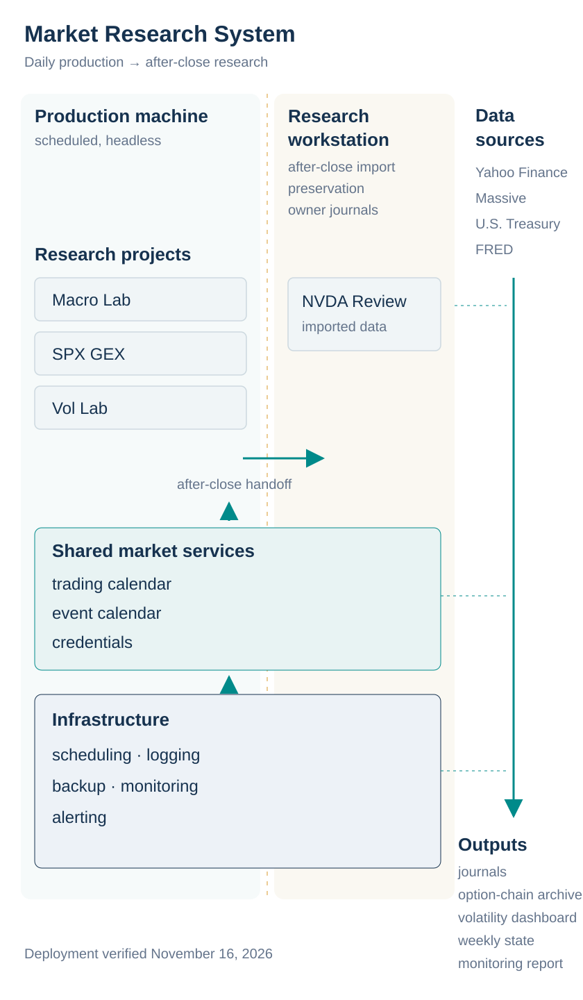
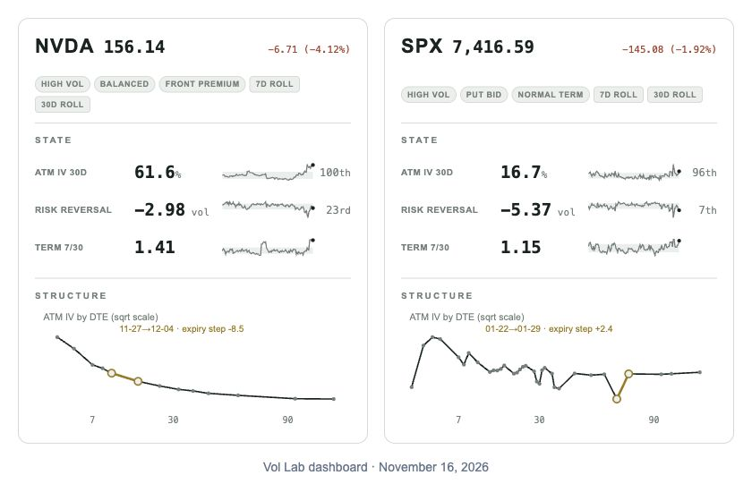

# Market Research System (Market Lab)

A personal market research system that runs every trading day: 17 scheduled workflows on a dedicated production machine collect, validate and process options and macro data from four providers (Yahoo Finance, Massive, U.S. Treasury, FRED) across four research projects, then hand off to a research workstation after the close. Operating since June 2026.

*17 scheduled workflows: 14 data and research producers, 1 operational-support schedule, 2 monitoring and control schedules.*

**Infrastructure** provides scheduling, logging, backup, monitoring and alerting.

**Shared market services** provide the trading calendar, event calendar and credential access.

**Research projects** turn market data into journals, an option-chain archive, a volatility dashboard and a weekly market state: Macro Lab, SPX GEX and Vol Lab run on schedule; NVDA Review runs after the close on the research workstation from the imported data.

Volatility master: 220 daily observations × 275 fields across NVDA and SPX, June 8 – November 16, 2026.

An end-of-day orchestrator produces an authoritative monitoring report (on November 16: 59 artifact checks, all OK), backed by an external heartbeat, push notifications and an email summary.

Real output samples, dated November 16, 2026: [NVDA Auto Snapshot excerpt](samples/nvda-auto-snapshot-2026-11-16.png) · [sanitized monitoring report](samples/watchdog-2026-11-16.md) · [report preview](samples/watchdog-2026-11-16.png).

Research writing: [Market Research Writing](https://app.notion.com/p/41b31be4dfe681e58c5bdb61cd5440f6?pvs=204).
